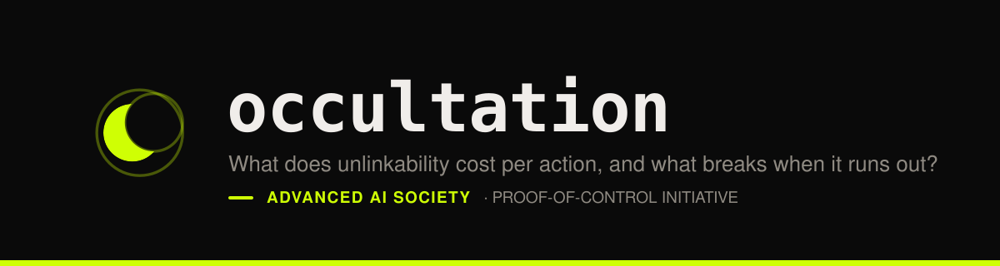

<p align="center">
  
</p>

<p align="center">
  
  
  
  
</p>

---

## "Both halves fit the budget"

A desk study costed anonymous credentials for autonomous agents against a
15 ms per-action budget. BBS+ presentation: about 13.8 ms. Verification: about
4.2 ms. Each one is under 15 ms, so each was marked acceptable, and the
construction was declared viable.

An action pays for both.

```console
$ occultation bench --composed

PUBLISHED — not measured on this stack. Source: research/Accountable Unlinkable Agent Identity.md
  COMPOSITION                              PRESENT    VERIFY     TOTAL  VERDICT
  naive (no pool, no cached pairings)     13.80 ms   4.20 ms  18.00 ms  MISSES by 3.00 ms
  cached pairings only                    13.80 ms   1.10 ms  14.90 ms  MARGINAL — 0.10 ms spare, which is not headroom
  pre-computation pool + cached pairings   2.80 ms   1.10 ms   3.90 ms  fits, 11.10 ms spare
```

18 ms against a 15 ms budget. The middle row is the more interesting failure:
cached pairings bring it to 14.9 ms, which is *under* the limit — by 100 µs,
with nothing left for the application, the network, or writing the evidence
record. This tool reports that as `MARGINAL` rather than a pass, because
calling it a pass is how the original error was made twice.

The mistake is in the addition, not in the silicon. Our hardware is much
faster — the composed path costs about 14× less here — and that changes
nothing about the arithmetic.

## What that turns into

Only one composition fits, and it is the one that depends on a pool of
pre-computed blinding factors. So a performance question becomes a security
question: **what happens when the pool runs out under burst?**

There are two available behaviours. Stall, or reuse. This tool stalls, and
reuse is not configurable — because we can show exactly what reuse costs.

Two presentations sharing one blinding factor have the same `Abar` and `D`, so
a relying party links them on sight. Worse, the two transcripts carry different
challenges over the same commitments, so the witness falls out by subtraction:

```
e    = (ê₁ − ê₂) / (c₁ − c₂)
m_j  = (m̂_j₁ − m̂_j₂) / (c₁ − c₂)
```

The signature scalar and every undisclosed attribute, recovered by anyone who
sees both. Reuse does not weaken unlinkability. It hands over the credential.
The test suite performs that extraction against known values rather than
asserting it.

Stalling is not free either:

```console
$ occultation pool --burst 5000 --duration 2s --refill 700us --online 60us

  requests             10000
  served from pool     89
  stalled              9911

  POOL EXHAUSTED

  idle response        60.000 µs
  amplification        82591.0x  (peak over this 2.0s window)

  duration-invariant figures (do not move with --duration):
  overload factor      3.50x arrivals over refill
  growth per request   8.33x idle-response added to each successive stall
  onset request        89

  distinct blinding factors issued   10000
  blinding-factor reuse events       0
  real pool exhaustions              9913
```

The pool empties after 89 requests and every one of the remaining 9,911 waits.
The delay does not plateau — it grows for as long as the burst lasts, so an
observer reads the agent's load, and the burst's duration, off response latency
alone. That is a side channel the design has to answer for, and nobody had
asked the question.

## And the anonymity set may not be there at all

Unlinkable credentials are worth nothing if the hardware underneath is
distinguishable. TDX quote collateral — TCB level, PCS chain, microcode — is
itself a fingerprint, so two agents on different patch levels are separable
*even under perfect ECDAA*.

```console
$ occultation anonymity --fleet examples/fleet-drifted.toml

  fleet size            120
  distinct TCB configs  5
  smallest set          1
  singletons            1
  effective set size    52.73
  entropy               1.470 bits

  SIZE   GROUPS
  71     us-east-pool-patched
  34     us-east-pool-pending
  11     eu-west-rack-7
  3      us-east-canary
  1      us-east-rebuilt-0419
```

120 identical hosts. Six weeks of entirely ordinary drift — a patch wave 60%
done, a rack that missed two maintenance windows, one machine rebuilt last
week — and the largest anonymity set is 71, with one host alone on its
configuration before any credential is presented. Nothing exotic happened.

**These fleets are synthetic, hand-authored fixtures, not telemetry from any
live deployment.** The tool partitions a fleet *description*. Point it at your
own.

## What is real, and what is not

Read this before trusting any number this tool prints. It is the first thing
in this file for a reason.

### Modelled — no security whatsoever

**ECDAA** (`ModelledEcdaa`) and **threshold ElGamal escrow**
(`ModelledThresholdElGamal`) are stubs. They carry the correct interface and a
representative cost profile. They provide **no anonymity, no soundness, no
confidentiality, and no accountability.** They exist so the cost of the
composed path can be estimated, and for nothing else. Using them for anything
that matters would be a serious mistake.

Four independent barriers, each asserted by test, stop one being mistaken for
the real thing:

1. They cannot be constructed without a `ModelledPermit`, which only
   `--allow-modelled` produces.
2. `AttestationVerdict::Valid` is unreachable from a modelled implementation —
   it returns `ModelledNoSecurity` for every input, including its own honest
   output.
3. Every invocation logs a warning.
4. Every value carries `Provenance::Modelled`, and every number they produce
   prints with `MODELLED` beside it, in the table and in the JSON.

Asking for one is different from accepting what it is: `bench --composed
--with-escrow` requests the modelled escrow tag, and without `--allow-modelled`
alongside it the tool exits 3 and explains why.

### Real, but not interoperable

**BBS+** key generation, signing, verification, presentation and proof
verification, over `blstrs` BLS12-381 against `draft-irtf-cfrg-bbs-signatures`.
Genuine cryptography with genuine security properties — forged signatures fail,
tampered proofs fail, undisclosed attributes stay undisclosed, and each is
asserted by test, including a total-forgery bypass and a replay the test suite
had to be rewritten to catch.

It is **not validated against the draft's test vectors**, so its wire encoding
will not interoperate with another BBS+ implementation. The cost profile is
what this tool is for. Interoperability is not claimed.

### Real

The Ed25519 baseline, the BLS12-381 group and pairing arithmetic, the
pre-computation pool, the anonymity-set calculator, and the timing harness.
`expand_message_xmd` is checked against all six RFC 9380 Appendix K.1 vectors,
plus two more at the length production actually uses, generated by a second
implementation written independently from the RFC.

### And one thing nothing here measures

**No command in this tool measures a pooled presentation's online phase.** The
pooled figure in `bench --composed` is an estimate — two hash-to-scalar
operations — and it is almost certainly too low: it implies a 99% reduction
where the desk study's own pooled figure implies 80%. `occultation pool` does
not measure it either; its default online cost is the same estimate. Every row
that carries it is labelled `ESTIMATED`.

## Where the numbers come from

Every figure is tagged. `measured here (n=…)` was timed on the host that
produced the output. `PUBLISHED — …` was read from a publication and was **not**
measured on this stack; the citation prints with it. `ESTIMATED` is derived
from a cheaper proxy and says what the proxy is.

`results/` is split. `deterministic/` is byte-identical on any host — CI
regenerates it and fails on a diff, so a stale number cannot outlive a code
change. `measured/` is wall-clock timing, regenerated and schema-checked but
not diffed, because failing a build over scheduler jitter teaches everyone to
ignore CI.

## Try it

```console
$ git clone https://github.com/Task-force-for-AI-agents-in-Healthcare/occultation
$ cd occultation
$ cargo test                                   # 196 tests, incl. the four acceptance tests
$ cargo run --release -- bench --composed      # the correction
$ cargo run --release -- pool --burst 5000     # exhaustion, and what it leaks
$ cargo run --release -- anonymity --fleet examples/fleet-drifted.toml
$ ./scripts/regen-results.sh                   # regenerate everything the paper cites
```

## The four commands

| Command | What it answers |
| --- | --- |
| `occultation bench` | What does each primitive cost against an Ed25519 sign-and-verify round trip? |
| `occultation bench --composed` | Does present **and** verify fit in 15 ms — as one path, not two? |
| `occultation pool --burst <rate>` | What happens when the pre-computation pool runs dry? |
| `occultation anonymity --fleet <f.toml>` | How large is the anonymity set once TCB configurations drift? |

Exit codes: `0` success, `1` policy violation (`--min-set`, `--max-stall`),
`2` bad input, `3` a modelled component requested without `--allow-modelled`.

## The paper

[`paper/main.pdf`](paper/main.pdf) — *What Unlinkability Costs at Agent Action
Rates: A Composed-Path Measurement and the Soundness of Pre-Computation.*
Builds with `cd paper && tectonic -Z shell-escape main.tex`.

Every figure in its results section is read from `results/` at build time.
None of them is typed by hand.

Supporting tool for **P05 — Accountable but Unlinkable Agent Identity**, part
of the [Proof-of-Control](https://github.com/Task-force-for-AI-agents-in-Healthcare)
research programme. Sibling tools: **parallax** (residual trust in attestation
tiers) and **transit** (effect binding).

## Licence

Apache-2.0 throughout, code and paper alike. See [`LICENSE`](LICENSE) and
[`NOTICE`](NOTICE). Copyright Advanced AI Society and the Proof-of-Control
contributors.
